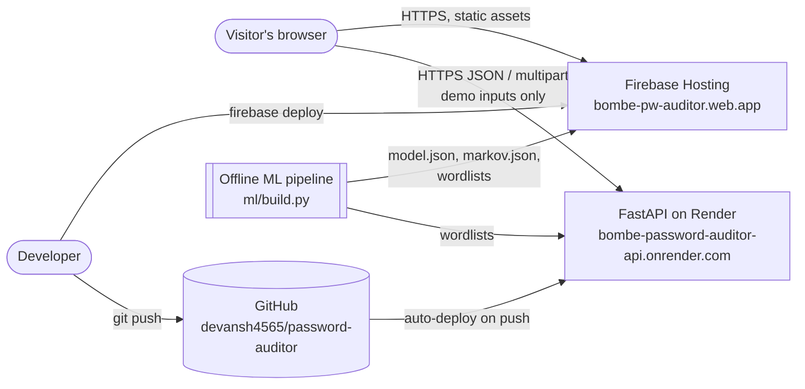
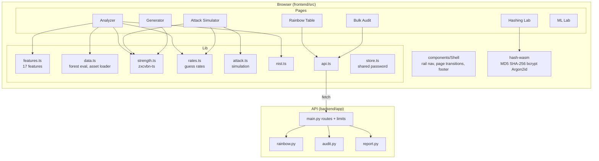

# Architecture

Password Strength & Secure Storage Auditor — CSN 446 / CSF 446, Project 4, DIT University.

## 1. System context

The visitor's own password is processed **only in the browser**. The server receives demo inputs: a ≤5-letter
plaintext for the rainbow-table demo, a password for optional server-side hash timing, and an uploaded CSV of
synthetic hashes for the bulk audit.

## 2. Containers

| Container | Tech | Responsibility | Hosting |
|---|---|---|---|
| Web app | React 19, Vite 6, Tailwind 4, Motion 12, React Router 7 | All seven tool pages, client-side analysis, ML inference, hashing (WASM), simulation | Firebase Hosting (static, CDN) |
| API | Python 3.12, FastAPI, slowapi, bcrypt, argon2-cffi, ReportLab | Rainbow-table lookup, server hash timing, bulk audit, PDF report | Render free web service |
| ML pipeline | Python, scikit-learn, zxcvbn (py) | Generate synthetic data, train RandomForest, export JSON, metrics, parity vectors | Developer machine (offline) |
| Rainbow builder | Python multiprocessing | Build MD5 chains for a-z length 4-5 | Developer machine (offline) |

## 3. Component map

## 4. Key decisions

| # | Decision | Why | Trade-off |
|---|---|---|---|
| AD-1 | Analyse passwords client-side | The product's core promise; a password checker that uploads passwords teaches the wrong lesson | Heavier bundle (zxcvbn dictionaries ~800 KB gz, split into a cached chunk) |
| AD-2 | Export the RandomForest as JSON and evaluate it in TypeScript (not ONNX) | 0.37 MB, no WASM runtime, instant | Feature code exists twice; guarded by a 60-vector parity test |
| AD-3 | Synthetic training data with process-defined labels | No breach data can leak or be redistributed; meets the brief's "synthetic examples" | Labels measure learned structure, not real-world guessability — stated on the ML page |
| AD-4 | Hashing Lab uses hash-wasm in the browser | Works while the free server sleeps; no password sent | Browser timings vary by device |
| AD-5 | Real rainbow table (hash-reduce chains), small keyspace | Demonstrates the actual technique, not a lookup dictionary | Only covers a-z length 4-5 (~79%) |
| AD-6 | Render free tier for the API | Zero cost, Git auto-deploy | Sleeps after 15 min; 512 MB RAM — Argon2 concurrency and upload sizes are rate-limited |
| AD-7 | Firebase site inside existing project | Account hit the 21-project quota | Hosting shares a project with StockPilot; `firebase.json` pins the site |

See `HLD.md` for module-level design and `LLD.md` for algorithms and data structures.
