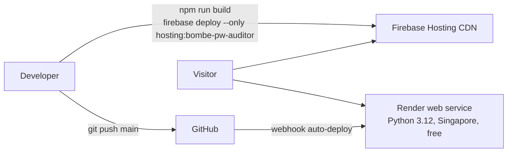

# Deployment



## Frontend — Firebase Hosting

- Site `bombe-pw-auditor` in project `stockpilot-9sqqn` (the Google account reached its 21-project quota, so a second
  Hosting site was added to an existing project instead of a new project).
- URL: https://bombe-pw-auditor.web.app
- `firebase.json` pins `"site": "bombe-pw-auditor"`, SPA rewrite to `/index.html`, immutable cache on `/assets/**`,
  security headers.
- Build-time config: `frontend/.env.production` → `VITE_API_URL=https://bombe-password-auditor-api.onrender.com`.

```bash
cd frontend && npm ci && npm run build
cd .. && firebase deploy --only hosting:bombe-pw-auditor --project stockpilot-9sqqn
```

## Backend — Render

- Service `bombe-password-auditor-api` (`srv-dbf534rrjlhs73fhd9q0`), free plan, Singapore, root dir `backend/`.
- Build `pip install -r requirements.txt`; start `uvicorn app.main:app --host 0.0.0.0 --port $PORT`; health `/health`.
- Env: `PYTHON_VERSION=3.12.7`, `CORS_ORIGINS=https://bombe-pw-auditor.web.app,https://bombe-pw-auditor.firebaseapp.com,http://localhost:5173`.
- Auto-deploys on every push to `main`. `render.yaml` documents the same config as a Blueprint.
- Free tier sleeps after ~15 min idle; open the API URL a minute before a demo to wake it.

## Local

```bash
cd backend && uvicorn app.main:app --reload --port 8000
cd frontend && echo VITE_API_URL=http://localhost:8000 > .env.local && npm run dev
```

## Rollback

Firebase: roll back from the Hosting release history in the console, or
`firebase hosting:clone bombe-pw-auditor@<version-id> bombe-pw-auditor:live`. Render: redeploy a previous commit from the dashboard or `render deploys create srv-dbf534rrjlhs73fhd9q0 --commit <sha>`.
