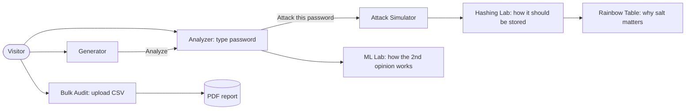

# High-Level Design

## 1. Goals

| Goal | Measure |
|---|---|
| Assess password strength locally | No network call carries the visitor's password on Analyzer, Attack, Generator, Hashing, ML pages |
| Explain *why*, not just *what* | Every verdict shows patterns, crack times with stated hardware, NIST checks |
| Demonstrate secure storage | Side-by-side MD5 / SHA-256 / bcrypt / Argon2id with measured timings |
| Demonstrate attacks safely | Simulated brute/dictionary/hybrid; real rainbow table on a toy keyspace; audit on synthetic CSV |
| Run for free, publicly | Firebase Hosting + Render free tier |

**Non-goals:** storing passwords or accounts, cracking real-world hashes, using real breach data.

## 2. Users and flows

The password typed on one page carries to the others through an in-memory store (`store.ts`); it is never persisted.

## 3. Modules

| Module | Location | Inputs | Outputs | Runs on |
|---|---|---|---|---|
| Strength estimator | `lib/strength.ts` (zxcvbn-ts) | password | score 0-4, guesses, matched patterns, feedback | Browser |
| Feature extractor | `lib/features.ts` ≡ `ml/features.py` | password, Markov model, dictionary | 17-number vector | Browser + Python |
| Classifier | `lib/data.ts` `forestProba` | feature vector, model.json | P(weak, medium, strong) | Browser |
| Crack-time model | `lib/rates.ts` | guesses | time per attacker profile | Browser |
| NIST checker | `lib/nist.ts` | password | 6 pass/fail checks | Browser |
| Attack simulator | `lib/attack.ts` | password, synthetic wordlist | animation frames, guesses tried | Browser |
| Hashing lab | `pages/Hashing.tsx` + hash-wasm | password | digests, per-hash ms | Browser (WASM) |
| Generator | `pages/Generator.tsx` | policy | password / passphrase, true entropy | Browser (`crypto.getRandomValues`) |
| Rainbow table | `backend/app/rainbow.py` | MD5 digest or plaintext(+salt) | recovered plaintext, chain walk, ops | Server |
| Bulk auditor | `backend/app/audit.py` | CSV (user, hash) | per-row result, stats, recommendations | Server |
| Report | `backend/app/report.py` | audit result | PDF | Server |
| ML pipeline | `ml/build.py` | vocab, EFF wordlist | model, Markov, dictionary, metrics, vectors | Offline |

## 4. Data artifacts

| File | Produced by | Consumed by | Size |
|---|---|---|---|
| `model.json` | ml/build.py | Browser classifier | 0.37 MB |
| `markov.json` | ml/build.py | features (both sides) | 28×28 log2 probs |
| `dictionary.json` | ml/build.py | features `dict_cover`, pattern finder | 7,954 words |
| `attack_wordlist.json` | ml/build.py | Attack sim, bulk audit | 7,375 synthetic entries |
| `eff_wordlist.json` | EFF (public) | Generator passphrases | 7,776 words |
| `ml_metrics.json` | ml/build.py | ML Lab | accuracy, confusion, importances |
| `test_vectors.json` | ml/build.py | parity test | 60 vectors |
| `rainbow_md5_l45.bin` | build_rainbow.py | API | 18,795 chains, 150 KB |

## 5. External interfaces

REST API, JSON unless noted — full contract in `API.md`.

| Method | Path | Purpose |
|---|---|---|
| GET | `/health` | liveness |
| POST | `/hash` | server-side timing of 4 algorithms |
| GET | `/rainbow/info` | table metadata, example crackable words |
| POST | `/rainbow/lookup` | crack an MD5 / plaintext(+salt) |
| POST | `/audit` | multipart CSV → JSON audit |
| GET | `/audit/sample` | synthetic CSV |
| POST | `/audit/pdf` | multipart CSV → PDF |

## 6. Cross-cutting concerns

- **Privacy:** client-side by default; server endpoints accept only demo inputs and store nothing (no DB, no logs of bodies).
- **Abuse resistance:** per-IP rate limits (slowapi), upload ≤400 KB and ≤500 rows, inputs length-capped by pydantic.
- **Availability:** frontend on a CDN is always up; server pages show a "waking up, retry in ~30 s" message on failure.
- **Accessibility:** keyboard focus rings in tool hue, ≥4.5:1 text contrast (ink text on light hues), reduced-motion
  disables drum spin and transitions.
- **Performance:** route-level code splitting; zxcvbn dictionaries in a separate immutable-cached chunk.
