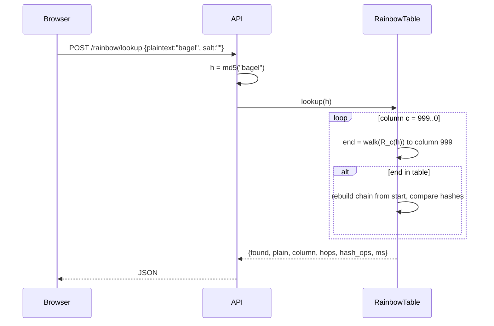

# Low-Level Design

## 1. Feature vector (`ml/features.py` ≡ `frontend/src/lib/features.ts`)

Iterate by Unicode code point on both sides (`[...pw]` in TS). Floats rounded to 6 dp.

| # | Name | Definition |
|---|---|---|
| 0 | length | number of code points |
| 1-4 | n_lower, n_upper, n_digit, n_symbol | ASCII class counts; anything not a-z/A-Z/0-9 is "symbol" |
| 5 | n_classes | classes present (0-4) |
| 6 | pool_entropy | `len × log2(pool)`, pool = 26/26/10/33 per class present |
| 7 | unique_ratio | distinct chars / len |
| 8 | max_repeat | longest run of identical chars |
| 9 | seq_run | longest run where adjacent code points differ by ±1 (lower-cased) |
| 10 | kb_run | longest run of QWERTY-adjacent keys (row/col distance ≤1) |
| 11 | markov_avg | mean log2 P(bigram) over `^letters$` after de-leet, from a model trained on English words |
| 12 | dict_cover | longest dictionary substring (≥3, de-leeted) / normalised length |
| 13 | digit_suffix | trailing digit count |
| 14 | has_year | any 4-digit 19xx/20xx |
| 15 | leet_count | leet glyphs (4 @ 3 1 ! 0 5 $ 7) between two letters |
| 16 | upper_first_only | first char upper and it is the only upper |

De-leet map: `4,@→a  3→e  1,!→i  0→o  5,$→s  7→t`.

## 2. Synthetic dataset and labels (`ml/build.py`)

20,000 unique passwords per class, seed 42.

- **weak** — 9 human patterns: word+suffix, leet word, name+year, keyboard walk, numeric sequence, word+fragment,
  short lowercase, ddmmyyyy date, word+symbol+"123".
- **medium** — two words + digits + symbol, leet EFF word + symbol + 4 digits, 8-10 random full-pool chars,
  EFF word + 4-5 random chars.
- **strong** — 13-24 random full-pool chars, 4-6 EFF-word passphrase, 18-28 random lowercase.

Label = generating process. Split 80/20 stratified. Model: `RandomForestClassifier(n_estimators=40, max_depth=12,
min_samples_leaf=8, random_state=42)`. Results: held-out accuracy 0.998; zxcvbn (0-1→weak, 2-3→medium, 4→strong)
agrees with the labels 78% of the time on a 1,500 sample.

## 3. Model export and inference

```json
{ "classes": ["weak","medium","strong"], "features": [...17],
  "trees": [ { "f": [featureIdx...], "t": [threshold...], "l": [leftChild...], "r": [rightChild...],
               "v": [[p_weak,p_med,p_strong] per node] } ] }
```

```
proba(x):  acc = 0⃗
  for tree:  n = 0;  while l[n] ≠ -1:  n = x[f[n]] ≤ t[n] ? l[n] : r[n]
             acc += v[n]
  return acc / nTrees
```

`build.py` asserts JSON inference equals `predict_proba` (atol 1e-3) for 200 test rows. `parity.mts` checks the TS
features and probabilities against 60 Python vectors (tolerance 1e-4 / 2e-3).

## 4. Crack-time model (`lib/rates.ts`)

`time = guesses / rate`, where `guesses` = zxcvbn estimate (Analyzer, Attack) or `2^(bits-1)` for the Generator, whose
true entropy is known: `bits = len × log2(|alphabet|)` or `words × log2(7776)`.

| Profile | Rate (guesses/s) | Source |
|---|---|---|
| Online, throttled | 10 | assumption |
| MD5 | 164 × 10⁹ | hashcat, 1× RTX 4090 |
| SHA-256 | 21.9 × 10⁹ | hashcat, 1× RTX 4090 |
| bcrypt cost 12 | 1.44 × 10³ | cost-5 benchmark ÷ 2⁷ |
| Argon2id 64 MiB | 400 | rough estimate |

## 5. Attack simulator (`lib/attack.ts`)

All three generators emit `Frame { guess, tried, found, lockedPrefix }`; the page plays them on an interval
(95 ms brute, 55 ms list modes).

- **Brute force:** odometer over the password's own character classes; each position scans the alphabet until it
  equals the target char, then locks. Visual shortcut, disclosed on the page — a real attacker gets only
  whole-string feedback.
- **Dictionary:** walks the synthetic list in order (cap 4,000), samples ~60 frames, stops on exact or lower-case match.
- **Hybrid:** top 400 words × 4 transforms (as-is, Capitalised, leet, @) × 12 suffixes, cap 6,000.

## 6. Rainbow table (`backend/app/rainbow.py`)

- Keyspace N = 26⁴ + 26⁵ = 12,338,352. `index_to_plain(i)`: i < 26⁴ → 4 letters else 5, base-26 little-endian.
- Hash H = MD5 hex. Reduction `R_k(h) = (int(h[:15],16) + k) mod N` — column-dependent, so merges only occur in the
  same column.
- Chain length t = 1,000; 80,000 random starts; chains with identical end-points deduplicated → 18,795 stored as
  `<II` (start, end) pairs, 150 KB. Measured coverage 79% (150 random plaintexts).
- **Lookup(h):** for column c = t-1 … 0: compute `R_c(h)` then walk to the end; if the end-point exists, regenerate
  each candidate chain from its start until H == h (false alarms continue). Worst case ≈ t²/2 = 500k MD5s (~2 s).
- Salted input is hashed as `md5(salt + plaintext)` and is (by design) absent from the table.



## 7. Bulk audit (`backend/app/audit.py`)

1. Parse CSV header; `hash` column required (aliases `password_hash`, `digest`); user column optional.
2. Detect algorithm per row: `$argon2id$` → argon2id, `$2a/b/y$` → bcrypt, hex length 32/40/64 → md5/sha1/sha256.
3. Fast hashes: lookup in precomputed `{digest → plaintext}` tables built once from the synthetic wordlist plus
   capitalise / `!` rules (~11.9k candidates × 3 algorithms). Slow hashes (bcrypt/Argon2id) are reported as
   strong storage and not attacked — the point of the demo is that they resist exactly this.
4. Aggregate: cracked count/%, algorithm histogram, weak-storage count, reuse (same recovered plaintext on >1 account),
   recommendations. Recovered passwords are masked (`pa*****d`).
5. `/audit/pdf` renders the same dict with ReportLab.

Limits: 400 KB body, 500 rows, 20 requests/min/IP.

## 8. Frontend state and motion

- `store.ts`: module-level string + `useSyncExternalStore`; no persistence.
- Route transitions: `AnimatePresence mode="wait"`, 220 ms ease-out-expo, opacity+8 px.
- Drum (`Drum.tsx`): rAF glyph cycling every 45 ms while `spinning`; lock = scale 1→1.08→1 over 220 ms; tool-hue fill.
- `prefers-reduced-motion`: drums show final glyph, CSS transitions clamp to 0.01 ms.
